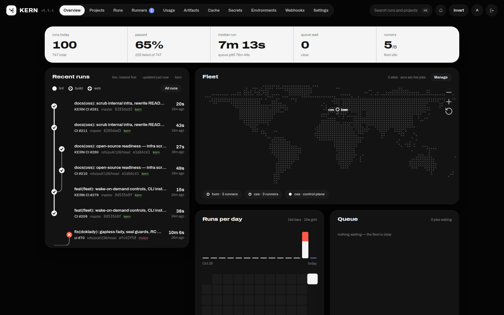
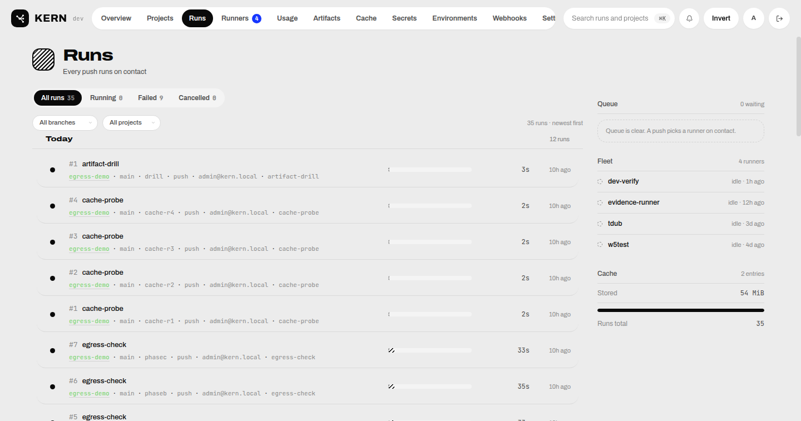
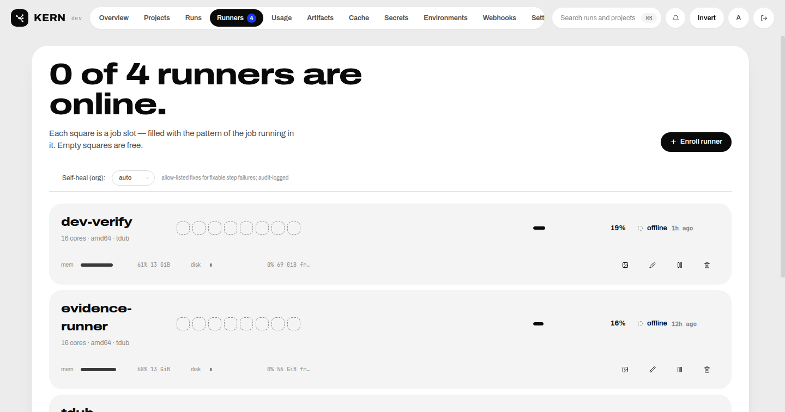
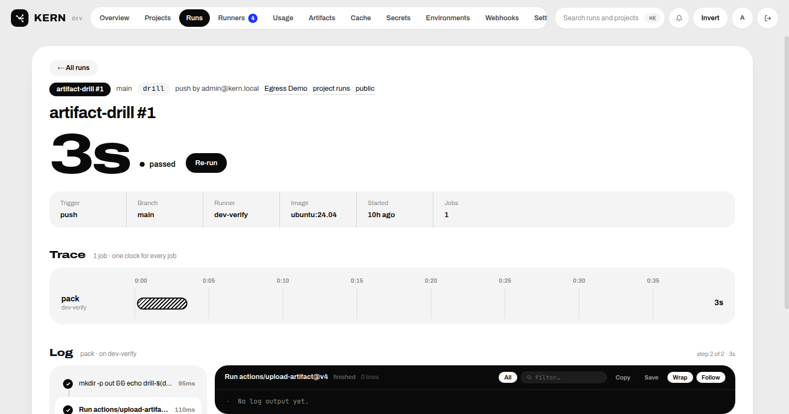

<p align="center">
  
</p>

# KERN

Distributed, self-hosted CI/CD that runs GitHub Actions workflow YAML on your
own infrastructure. GitHub stays your source-code host; KERN owns the control
plane, scheduler, execution engine, and storage — no cloud account, no
per-minute billing, no code leaving your machines.

## Why KERN

- **Your workflows, unchanged** — KERN compiles standard
  `.github/workflows/*.yml`: `needs` DAGs, matrices, `if`/expressions,
  `concurrency`, `environment` approvals, reusable workflows, service
  containers, and the popular actions (`checkout`, `cache`, artifacts).
- **Your machines** — the runner agent enrolls with a one-time token and
  polls outbound-only. Any Docker host becomes capacity: bare metal, VMs,
  containers, macOS and Windows hosts via the host executor.
- **One Go binary + Postgres** — no message queue, no Kubernetes required.
  Compose file included; the API also serves the dashboard.
- **Full control plane** — web dashboard, `kern` CLI, REST API, Prometheus
  metrics, audit log, AES-256-GCM secrets, environment approvals,
  self-healing retries, signed auto-updates.

Status: **v0.5.x, running production workloads.** The honest GitHub Actions
feature matrix is [docs/compatibility.md](docs/compatibility.md).

## Screenshots

| Overview | Runs |
| --- | --- |
|  |  |

| Runners | Run detail |
| --- | --- |
|  |  |

## Quickstart

Requires Go 1.27+, Docker, PostgreSQL 16, and [`just`](https://github.com/casey/just).

```sh
# 1. Postgres (any reachable instance)
docker run -d --name kern-pg -p 5432:5432 \
  -e POSTGRES_USER=kern -e POSTGRES_PASSWORD=kern -e POSTGRES_DB=kern \
  postgres:16-alpine

# 2. Control plane — migrations + bootstrap admin run at boot
just dev          # http://localhost:8080, admin@kern.local / kern-admin-password

# 3. Runner agent on any machine with Docker
just runner       # enrolls, heartbeats, claims jobs

# 4. Dashboard (optional)
cd apps/web && pnpm install && pnpm dev   # http://localhost:5173
```

Production-style deployment: `docker compose -f deployments/docker-compose.yml up -d`
— the full checklist (env vars, GitHub App, ingress, auto-update) is in
[docs/deploy.md](docs/deploy.md).

## Components

| Path | What it is |
| --- | --- |
| `cmd/api` | Control plane: HTTP API, auth, scheduler, orchestrator, webhooks |
| `cmd/runner` | Runner agent: enrolls, claims, executes steps in ephemeral containers |
| `cmd/kern` | `kern` CLI: auth, projects, runs, runners, secrets, settings, `exec` |
| `cmd/migrate` | Standalone migrator (also runs at api boot) |
| `internal/` | Platform packages — see [docs/architecture.md](docs/architecture.md) |
| `apps/web` | Dashboard: React 19 + Vite + Tailwind |
| `migrations/` | Versioned PostgreSQL schema (goose) |
| `deployments/` | Compose file, Dockerfiles, updater + scaler scripts |

## Feature highlights

- **Workflow engine** — static plan compile; `needs` DAG, matrix
  include/exclude/fail-fast, `strategy.split` fan-out, expressions,
  `concurrency` groups, timeouts, `continue-on-error`.
- **Action runtimes** — `run` steps, local + remote composite actions,
  `node*` JavaScript actions (hash-verified), `docker://` and Dockerfile
  actions, lifecycle hooks, native `checkout`/`cache`/artifact actions.
- **Reusable workflows** — `jobs.<id>.uses` expansion with inputs/outputs;
  service containers on per-job networks with health waits.
- **GitHub App integration** — push/PR webhooks, commit statuses and check
  runs as the App, manifest "Connect GitHub" flow, fork trust levels and an
  approval gate.
- **Runner fleet** — enrollment tokens, live cpu/mem/disk heartbeats,
  least-loaded placement, hardened job containers (non-root uid, dropped
  caps, read-only root, resource limits), persistent tool caches, image GC,
  host executor for macOS/Windows, JIT ephemeral runners, wake-on-demand
  scaling hooks.
- **Operations** — AES-256-GCM secrets, server-side log masking, environment
  approvals, audit log, `/metrics`, retention sweeps, signed-release
  auto-update, `kern exec` remote offload.

## Documentation

| Doc | Contents |
| --- | --- |
| [docs/architecture.md](docs/architecture.md) | Processes, request flow, isolation, scheduler, ADRs |
| [docs/compatibility.md](docs/compatibility.md) | GitHub Actions feature matrix — what works today |
| [docs/connect.md](docs/connect.md) | Bind a repo to the fleet; `runs-on` label matching |
| [docs/deploy.md](docs/deploy.md) | Production checklist, GitHub App, auto-update |
| [docs/autoscaling.md](docs/autoscaling.md) | Runner scaling options + wake-on-demand controls |
| [docs/backups.md](docs/backups.md) | Backup + restore runbook |
| [docs/runbook.md](docs/runbook.md) | Operations runbook — symptom → check → fix |
| [docs/remote-exec.md](docs/remote-exec.md) | `kern exec` remote execution offload |
| [docs/production.md](docs/production.md) | Remaining gaps for enterprise readiness |
| [plan.md](plan.md) | Milestone ledger |
| [project.md](project.md) | Product specification |

## Agent skills

This repo ships agent skills under `skills/`, installable with the
[skills CLI](https://skills.sh):

```sh
npx skills add Dvorinka/kern@kern-ops
```

| Skill | Contents |
| --- | --- |
| [skills/kern-ops](skills/kern-ops/SKILL.md) | Fleet operations — runner lifecycle, version stamping, drain discipline, env-file corruption, run triage, release chain |

## Contributing

Issues and PRs welcome. `just build` / `just test` / `just vet`, and
`cd apps/web && pnpm lint && pnpm build` before pushing. Store integration
tests need `KERN_TEST_DATABASE_URL` pointing at a throwaway Postgres
database whose name contains `kern_test`.

## License

MIT — see [LICENSE](LICENSE).
