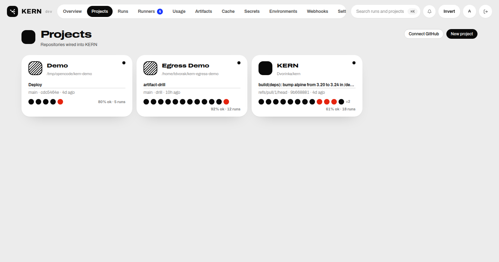
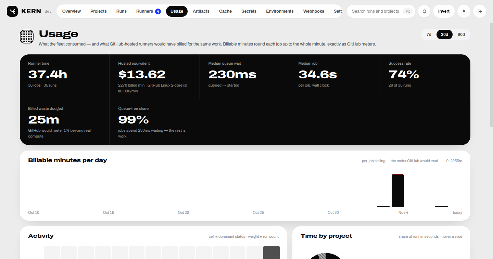

<p align="center">
  
</p>

# KERN

Distributed, self-hosted CI/CD platform that executes existing GitHub Actions
workflow YAML on your own infrastructure. GitHub stays the source-code
provider; KERN owns the control plane, scheduler, execution engine and storage.

Status: **v0.4.2, dogfooded in production.** The full loop runs live —
GitHub App webhooks → compiled run → ephemeral container on a registered
runner → commit status/check-run posted back — including composite,
JavaScript and Docker actions, reusable workflows, service containers and
environment approvals. Native macOS runners are proven end to end
(launchd agent on a Proxmox VM, autoscaled on queued `runs-on: macos`
work). The honest feature matrix is `docs/compatibility.md`; remaining
production gaps are tracked in `docs/production.md`.

## Screenshots

| Overview | Runs |
| --- | --- |
|  |  |

| Projects | Usage |
| --- | --- |
|  |  |

| Runners | Run detail |
| --- | --- |
|  |  |

## Components

| Path | What it is |
| --- | --- |
| `cmd/api` | Control plane: HTTP API, auth, scheduler, orchestrator, log ingestion, webhooks |
| `cmd/runner` | Runner agent: enrolls, long-polls for jobs, executes steps in ephemeral containers |
| `cmd/kern` | `kern` CLI: full control-plane client — auth, projects, runs, runners, artifacts, cache, `exec` offload, `split` |
| `cmd/migrate` | Standalone migration runner (migrations also run at api boot) |
| `internal/` | Platform packages (see `docs/architecture.md`) |
| `apps/web` | Dashboard — React 19 + Vite + TS strict + Tailwind: overview, projects, runs (DAG + live logs), runners, secrets, artifacts, cache, environments, usage, audit, settings |
| `migrations/` | Versioned PostgreSQL schema (goose) |
| `deployments/` | Docker Compose + Dockerfiles + auto-update sidecar script |

## Feature highlights

- **Workflow engine** — parses GitHub Actions YAML into a static plan;
  `needs` DAG, matrices with include/exclude/fail-fast, `strategy.split`
  fan-out, `if`/expressions, `concurrency` groups, `timeout-minutes`,
  `continue-on-error`.
- **Action runtimes** — `run` steps, local + remote composite actions,
  `node*` JavaScript actions (pinned Node, hash-verified), `docker://` and
  Dockerfile actions, action lifecycle hooks (`pre`/`post`), and native
  `actions/checkout`, `actions/cache`, upload/download-artifact.
- **Reusable workflows** — `jobs.<id>.uses` compile-time expansion with
  inputs/outputs and a boundary job; service containers on a per-job
  network with health waits.
- **GitHub App integration** — push/pull_request/pull_request_target
  webhooks, commit statuses + check runs as the App, manifest-based
  "Connect GitHub" flow, fork trust levels and a fork approval gate.
- **Runner fleet** — one-time enrollment tokens, heartbeats with live
  cpu/mem/disk, least-loaded placement, per-job container hardening
  (uid 1000, dropped caps, read-only root, resource limits), persistent
  tool caches with a bounded LRU, image GC, load gates. Docker executor
  plus a host executor for native jobs; custom runner icons; JIT
  single-job runners; proven on Linux containers and macOS (launchd,
  autoscaled VM on demand).
- **Operations** — AES-256-GCM secrets at rest, server-side log masking,
  environment approvals, audit log, Prometheus `/metrics`, retention
  sweeps, signed-release auto-update, `kern exec` remote offload.
- **Self-healing** — every failed step gets a structured diagnosis;
  an opt-in `allow_fix` ladder can retry once with an allow-listed fix.

## Quickstart

Requires Go 1.26+, Docker, PostgreSQL 16, and `just`.

```sh
# 1. Postgres (any reachable instance)
docker run -d --name kern-pg -p 5432:5432 \
  -e POSTGRES_USER=kern -e POSTGRES_PASSWORD=kern -e POSTGRES_DB=kern \
  postgres:16-alpine

# 2. Control plane (migrations + bootstrap admin run at boot)
just dev          # http://localhost:8080, admin@kern.local / kern-admin-password

# 3. Runner agent (any machine with Docker; outbound-only)
just runner       # registers, heartbeats, long-polls for jobs

# 4. Dashboard (optional — `just dev` serves the API only)
cd apps/web && pnpm install && pnpm dev   # http://localhost:5173

# 5. Create a project pointing at a repo checkout, then sync + trigger
curl -b cookies -c cookies -X POST localhost:8080/api/v1/auth/login \
  -H 'Content-Type: application/json' \
  -d '{"email":"admin@kern.local","password":"kern-admin-password"}'
curl -b cookies -X POST localhost:8080/api/v1/projects \
  -H 'Content-Type: application/json' \
  -d '{"slug":"demo","local_path":"/path/to/repo"}'
curl -b cookies -X POST localhost:8080/api/v1/projects/demo/sync
curl -b cookies -X POST \
  localhost:8080/api/v1/projects/demo/workflows/<workflow-id>/runs -d '{}'
```

Environment variables are documented in `.env.example`. Production-style
deployment: `docker compose -f deployments/docker-compose.yml up -d` with the
required secrets set — see `docs/deploy.md` for the full checklist including
the GitHub App, ingress tunnel, and automatic updates.

## Development

```sh
just build    # go build ./...
just test     # go test ./... -count=1
just vet      # go vet ./...
just migrate  # apply migrations only
cd apps/web && pnpm build && pnpm lint
```

## Documentation

| Doc | Contents |
| --- | --- |
| `docs/architecture.md` | Processes, request flow, isolation, scheduler, ADRs |
| `docs/compatibility.md` | Honest GitHub Actions feature matrix |
| `docs/connect.md` | Bind a repo to the fleet; `runs-on` label matching |
| `docs/deploy.md` | Production checklist, GitHub App, auto-update |
| `docs/backups.md` | Backup + restore runbook |
| `docs/remote-exec.md` | `kern exec` remote execution offload |
| `docs/production.md` | What remains for enterprise/production readiness |
| `plan.md` | Milestone ledger |
| `project.md` | Product specification |
